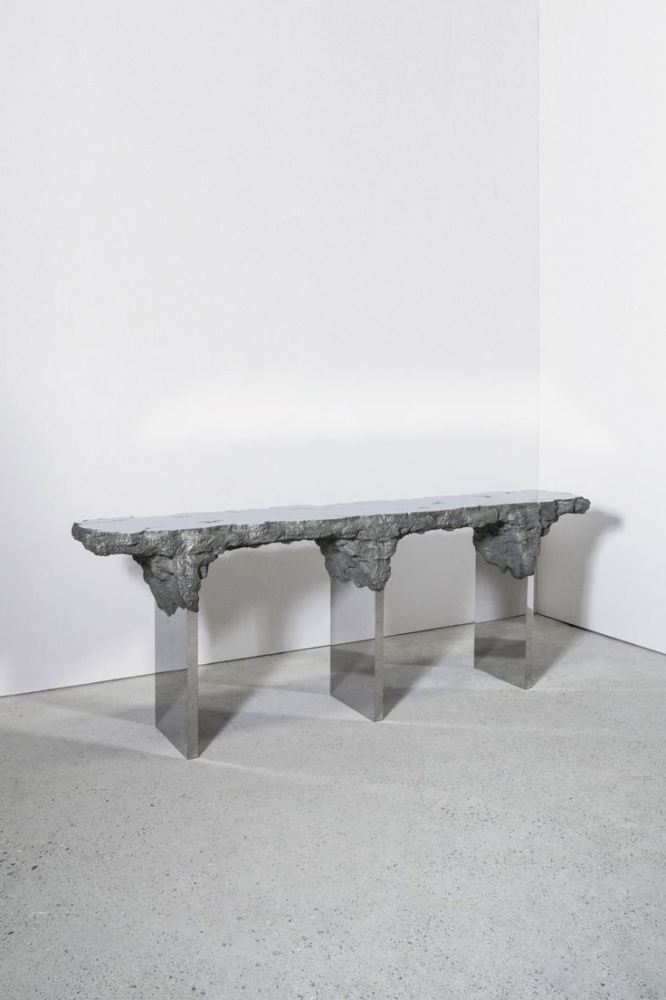
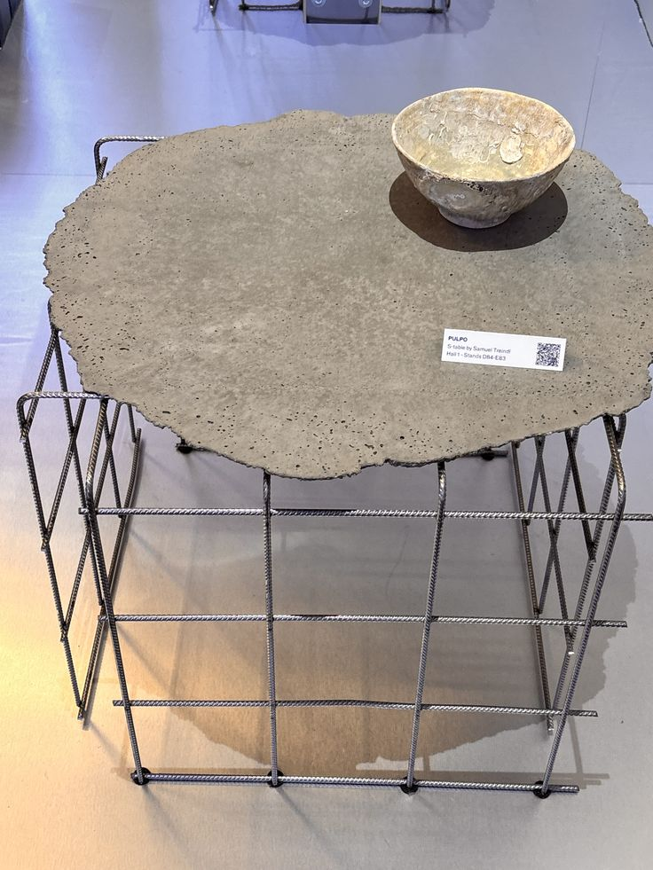
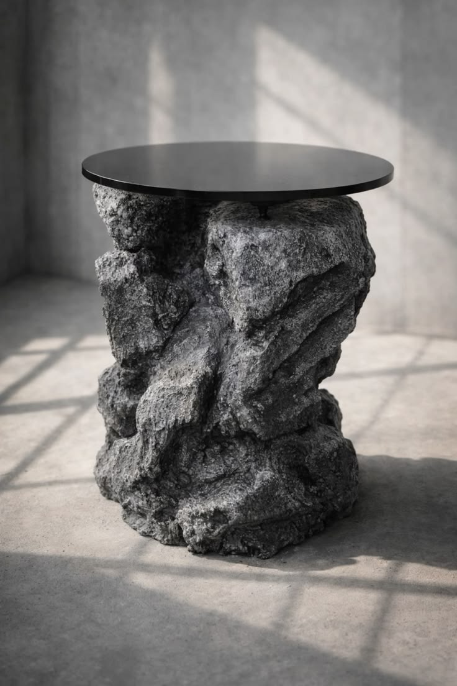
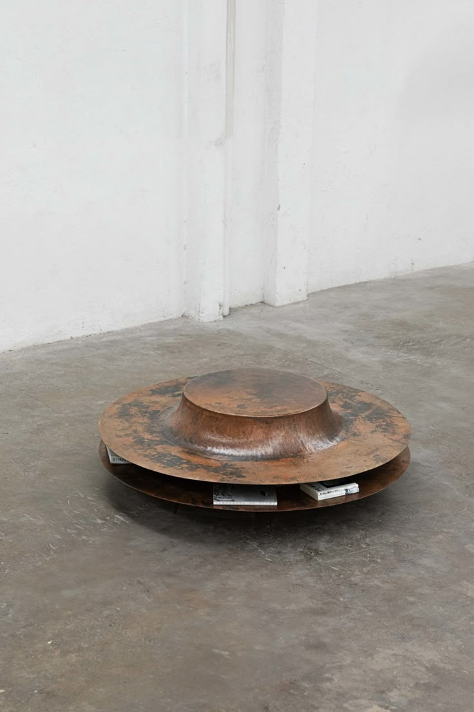
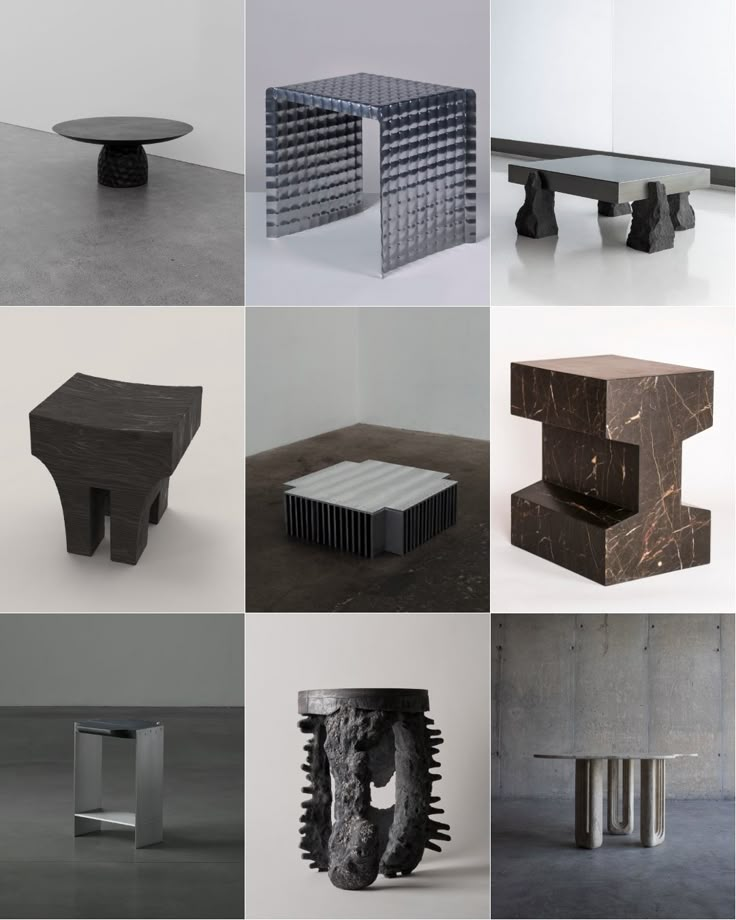

# Desarmar las referencias

Las preguntas son las de tu método: **qué hace** cada referencia (aporta un orden, una técnica o una pregunta), **qué se toma, qué cambia, qué se deja y por qué**. Para leer las piezas se usa el **Cuadro 1** del artículo (⊥ apoyo · ○ vano · ● masa · = límite), y se le agrega una quinta categoría para este proyecto: **✕ unión**, el lugar donde las otras cuatro se encuentran.

Las imágenes están en [`../01_reunir/referencias_visuales/`](../01_reunir/referencias_visuales/). **No se sabe de dónde vienen** (salvo la n.º 2, que lleva cartela): hay que averiguarlo antes de usarlas en la lámina 1, y conviene no publicarlas mientras tanto (ver [`../00_encargo/bases.md`](../00_encargo/bases.md)).

---

## Las cinco imágenes

### Ref. 01 · Banco-consola de masa rugosa sobre hojas de acero espejo

- **Lo que se ve**: un tablero largo de masa gris rugosa (¿fundición?, ¿piedra?, no se sabe) con la cara superior cortada plana. Tres apoyos de chapa de acero pulida en V. En cada apoyo **la masa baja** y envuelve el remate de la pata como una gota o un capitel.
- **Cuadro 1**: ● arriba (el tablero es la masa). ⊥ las hojas de espejo, que reflejan el suelo y casi desaparecen. = un corte plano a través de la masa. ✕ la masa engrosa donde encuentra el apoyo.
- **Qué hace**: invierte el orden de Semper (masa arriba) y pone el **peso visual en la unión**.
- **Se toma**: que la unión se marque con un **engrosamiento** de la masa, y que el límite superior sea un **corte** que deja ver el interior mientras los cantos quedan en bruto.
- **Cambia**: en madera maciza, el contraste corte/bruto puede darse entre la cara cepillada y el canto hendido o aserrado.
- **Se deja**: el acero espejo (contradice el macizo protagonista) y la masa que imita roca.

### Ref. 02 · *PULPO* — S-table, de Samuel Treindl (según la cartela de feria)

- **Lo que se ve**: un tablero de hormigón de borde irregular sobre una jaula de barras corrugadas soldadas.
- **Cuadro 1**: ● = el tablero es masa y límite a la vez. ⊥ la armadura. ○ la jaula vacía. ✕ los puntos de soldadura bajo la losa.
- **Qué hace**: **desarma un material compuesto**. El hormigón armado esconde su armazón (la barra) dentro de la masa; aquí el armazón sale y se vuelve el apoyo. Es Semper (F06-F07) hecho objeto: la tectónica separada de la estereotomía que la ocultaba.
- **Se toma**: la operación de **sacar a la vista lo que el material esconde**. En un mueble de macizo lo escondido es la unión (espigas, tornillos, herrajes), así que la unión debe verse.
- **Cambia**: aquí el armazón es industrial y anónimo. En la mesa el armazón es de **ebanistería**, que es justo lo que premia el jurado (criterio 2).
- **Se deja**: la barra, el hormigón y el borde de colada (el colado no es un proceso del macizo).

### Ref. 03 · Masa rocosa con disco negro apoyado en un punto

- **Lo que se ve**: una base facetada como de roca apilada y un disco negro fino (¿vidrio?, ¿laca?) que toca la masa en un pivote pequeño. ⚠️ La luz y la textura hacen sospechar que es un **render**. Procedencia por verificar.
- **Cuadro 1**: ● abajo, total. = el disco. ✕ **un punto**.
- **Qué hace**: reduce la unión a lo mínimo. Plantea una **pregunta**: ¿cuánto contacto necesita la unión para seguir siendo unión?
- **Se toma**: la pregunta, no la forma.
- **Se deja**: la roca imitada. Es el mayor **riesgo de folklorismo** del conjunto: la «roca andina» como imagen. Semper define la estereotomía por el **corte** («quitando partes de la masa», F07), no por la imitación de la naturaleza.

### Ref. 04 · Dos discos de metal patinado con un tambor embutido

- **Lo que se ve**: una mesa baja de dos discos de chapa oxidada (¿cobre?, ¿corten?). El superior tiene un tambor central embutido o repujado. Entre los discos, libros.
- **Cuadro 1**: = ● el disco superior es límite y masa a la vez. ○ el entre-discos se usa (libros). ⊥ el disco inferior.
- **Qué hace**: aporta una **técnica**: **una sola operación de fabricación genera la forma** (repujar una chapa), y la pátina registra el tiempo.
- **Se toma**: (1) la forma debe salir de una operación propia del macizo (aserrar, hender, tornear, cajear, acuñar), no aplicarse; (2) el **acabado como registro del tiempo**. Esto toca el criterio 3 (acabados) y la *nobilitazione* de las bases. El nogal canaleta cambia de tono con la luz: se puede proyectar ese cambio.
- **Se deja**: el metal y la tipología de mesa baja.

### Ref. 05 · Cuadrícula de nueve piezas

- **Lo que se ve**, de izquierda a derecha y de arriba abajo: (1) disco negro sobre base facetada tallada; (2) taburete de aluminio martillado; (3) losa pulida sobre bloques de roca; (4) taburete de madera oscura tallado en bloque, con patas gruesas; (5) mesa baja de aletas de aluminio; (6) mesa de bloques de mármol oscuro de vetas doradas, de perfil en I (parece **Saint Laurent**, que está en el catálogo de Porada); (7) taburete de chapa plegada; (8) pieza escultórica de madera quemada con púas; (9) mesa de patas en U de piedra clara (¿travertino?).
- **Qué hace en conjunto**: es un **diagnóstico de tu mirada**. Siete de nueve son **monolitos o tableros posados sobre una masa**, y en casi ninguna se ve una unión. Las referencias **tiran hacia la masa**; el concurso **tira hacia el armazón de madera** (*Gestell*, F06). El proyecto tiene que resolver esa tensión, no elegir un lado sin decirlo.
- **Se toma**: (4) y (8) muestran que **la madera también puede ser masa** (tallada en bloque, estereotomía en madera). De ahí sale la versión de control V3, toda en madera. (6) da un mármol de catálogo con carácter.
- **Se deja**: el aluminio (2, 5, 7) y la escultura sin función (8).

---

## Las referencias de texto: qué trabajo hace cada una

| Ref. | Aporta | Se toma | Cambia | Se deja | Por qué |
|---|---|---|---|---|---|
| F01 Bertonio, *Chhakhua* | pregunta | la unión como **piedra fija donde se ata la madera**; la palabra nombra el conjunto | de muro y techo a mesa; de atar a trabar | el montón (*chakhua*) como figura del proyecto | son dos palabras: el proyecto es una unión, no un lastre (E5) |
| F02 Bertonio, «Mesa» | objeción | la mesa como mueble ajeno | — | la idea de «mesa andina» | sin nombre aymara en 1612: no se puede atribuir |
| F03 *Cchacuru* | técnica | cuña y estaca: **acuñar, hincar** | — | el eco con las estacas de propiedad como argumento | es sugerente, pero no está demostrado |
| F05 Semper, *Vier Elemente* | orden | masa abajo, madera arriba | se puede invertir, pero a conciencia | — | da la regla contra la que se mide el borrador |
| F06 Semper, *Gestell* | pregunta | la mesa es tectónica por tipo | ¿dónde entra la masa? | — | redefine el problema |
| F07 Semper, estereotomía | técnica | **la piedra a compresión** | — | — | coincide con Kessler: es un criterio K2 |
| F08 Squier, Tiwanaku | técnica + referencia explícita | piedra **ensamblada como madera** (caja y espiga, grapa, perno) | se invierte: madera trabada con piedra | metalurgia y fechas | antecedente andino constructivo, no iconográfico |
| F09 Viollet-le-Duc, *tréteaux* | orden + escenario | mesa que **se arma** frente a mesa de piedra **fija** | — | — | la tensión ya está en la historia del tipo |
| F10 Viollet-le-Duc, *goussets* | técnica | el *roulement des pieds* se resuelve **con ensamble** | — | — | control del ensayo E3: el peso no traba |
| F11-F13 FPL, Kessler | técnica | datos con página | — | — | hacen falsables los ensayos |

Lo que el borrador atribuía a Galen Johnson (la veta como tiempo) **ya tiene página** (F15, pp. 63-64, de segunda mano). Johnson aporta además «pensar como el agua» (p. 70): la madera sin cola, que respira.
