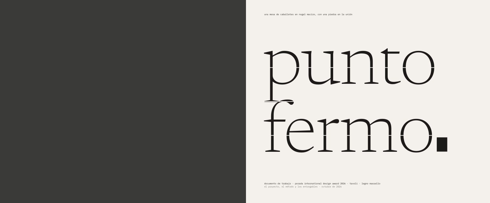
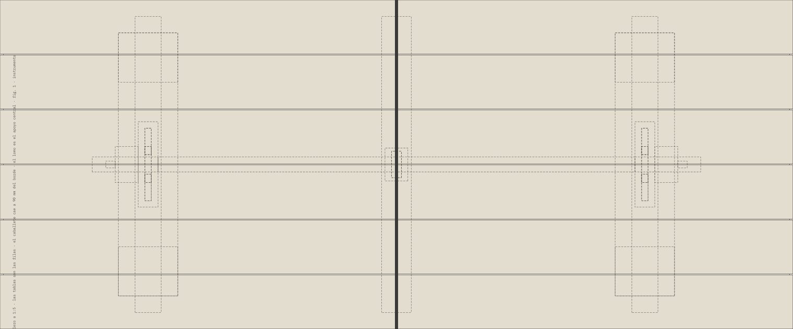
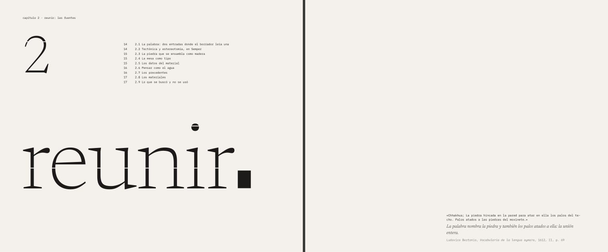
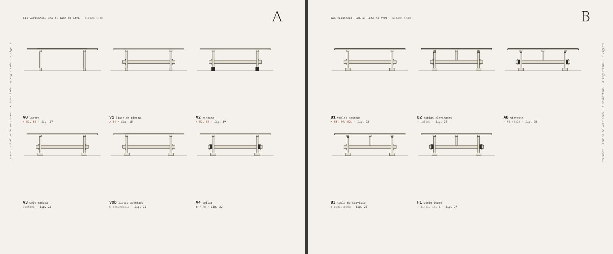
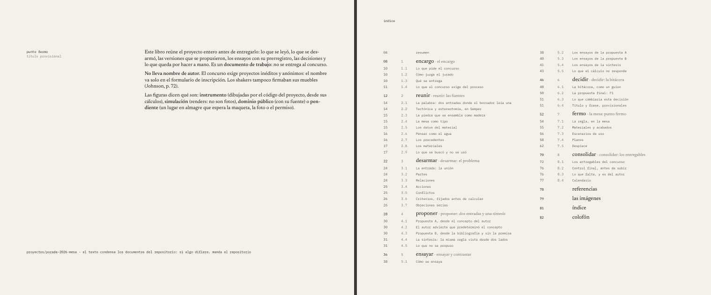
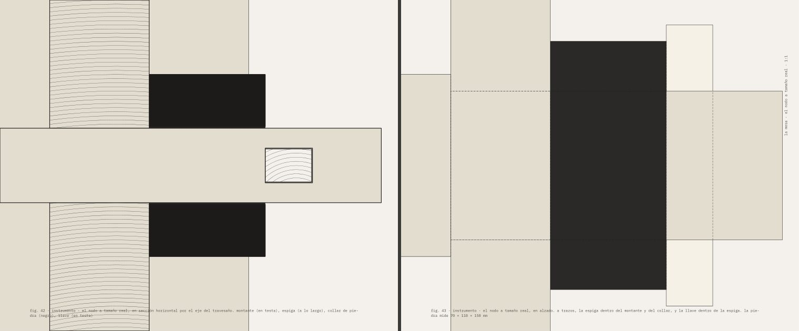
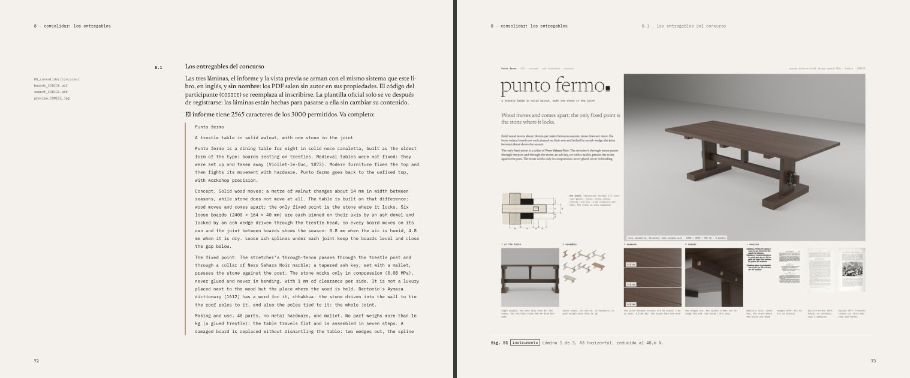

# El libro de *Punto fermo* y los entregables del concurso

Un solo sistema editorial para todo lo que sale del proyecto:

- **el libro**: el proyecto entero, con su método, sus fuentes, sus ensayos, sus decisiones y lo que falta hacer a mano;
- **los entregables del concurso**: tres láminas A3, el informe A4 y la vista previa, en inglés y sin nombre.



| Archivo | Qué es |
|---|---|
| `punto_fermo_libro.pdf` | **El libro**: 240 × 200 mm, 82 páginas, sobre el papel del proyecto. Documento de trabajo: no se entrega al concurso |
| `../concurso/boards_CODICE.pdf` | Las **tres láminas A3** horizontales, en un PDF de 0,9 MB (máx. 5) |
| `../concurso/report_CODICE.pdf` | El **informe**: una página A4, 2565 caracteres con espacios (máx. 3000), sin imágenes, con solo el código y el título en la cabecera |
| `../concurso/preview_CODICE.jpg` | La **vista previa**: 0,1 MB (máx. 1), sin metadatos |
| `muestras/` | Once dobles páginas en JPG |
| `armar.py` | Arma todo: `python3 armar.py` |
| `libro.py`, `contenido.py`, `estilo.css` | Las piezas, el contenido del libro y el sistema en CSS |
| `concurso.py`, `concurso.css` | Las láminas, el informe y la vista previa |
| `fuentes/` | Newsreader e IBM Plex Mono, con sus licencias (SIL Open Font License) |

## Cómo se arma

```
cd proyectos/porada-2026-mesa/05_consolidar/editorial
npm install                         # una vez: Vivliostyle CLI 11.3.3
python3 armar.py                    # láminas, informe, vista previa y libro (~1,5 min)
python3 armar.py --solo-libro       # solo el libro
python3 armar.py --codigo P123456   # con el código del participante en los nombres de archivo y en la cabecera
python3 armar.py --sin-pdf          # solo los HTML en .cache/, para `npx vivliostyle preview`
```

Necesita Node, Python 3 con Pillow, NumPy, PyMuPDF y shapely, y Chromium (el de Playwright, o el que diga la variable `CHROMIUM`). Los planos, los gráficos y el despiece se generan en el momento desde el instrumento (`../../instrumentos/mesa/`): si cambia un cálculo, cambia el libro. Los renders salen de `../renders/` (Blender, `../../instrumentos/blender/`).

Antes de entregar: `--codigo` con el código real, revisar la lista de control del capítulo 8 y pasar las láminas a la plantilla oficial, que solo se ve al registrarse.

## El sistema: el libro es la mesa

Como en *Contenida*, donde el libro era la caja, el formato y la retícula salen del proyecto.

**Formato.** La doble página es **el tablero a 1:5**: 480 × 200 mm son los 2400 × 1000 mm de la mesa. Cada página mide 240 × 200.

**Retícula.**
- **Filas**: seis filas de 32,83 mm, que son las seis tablas de 164 mm a 1:5. Entre ellas va la junta de fabricación, 3 mm a 1:5 = 0,6 mm. Las imágenes que se apilan quedan separadas por la junta.
- **Columnas**, desde el borde: aire 0–18 · margen 18–82 · **cabezal** 82–98 (el caballete a 1:5) · texto 98–222 (124 mm) · aire 222–240.
- **Interlínea**: la octava parte de una tabla y su junta, 4,179 mm. Hay 36 líneas de la segunda tabla al pie.
- El **lomo** es el apoyo central de la mesa. En las planas (páginas compuestas) la doble es la mesa entera: el caballete cae a 90 mm de cada borde. Las páginas de texto no se espejan, como en *Contenida*.



**Letras.**

| Uso | Letra |
|---|---|
| Texto | Newsreader 400, 9,6 pt |
| Palabras de apertura, cifras grandes | Newsreader 200 y 300 |
| Lo medido: datos, cotas, pies, índices, el guion | IBM Plex Mono 400 a 600 |

**Tintas.** Hay dos tintas:
- **Tinta**.
- **Almagre**, el rojo del cordel con que el carpintero marca antes de cortar. En el libro marca lo prerregistrado (lo que se escribió antes de calcular) y lo pendiente (lo que falta hacer a mano).
- **La piedra va en negro lleno**: en los cortes de los planos y como punto final de las palabras de apertura.

**Las aperturas.** Cada capítulo abre con un verbo del método en Newsreader 200 de 72 mm. Las juntas de las tablas lo cortan, y el punto final es un rectángulo negro con la proporción del collar (110 × 150), **lo único que la junta no corta**. *Punto fermo* es, en italiano, el punto final.



**Las figuras dicen qué son.** Llevan una etiqueta:

| Etiqueta | Qué es |
|---|---|
| `instrumento` | dibujada por el código del proyecto desde sus cálculos |
| `simulación` | render, con marco a trazos: no es una foto |
| `dominio público` | con su fuente y su página |
| `pendiente` | un lugar punteado en almagre que espera la maqueta, la foto o el permiso |

Las cinco referencias visuales del borrador no se reproducen: su autoría no está verificada.

## Lo que toma de las tres referencias

| Referencia | Lo que tiene | Lo que toma el libro |
|---|---|---|
| **El libro con forma de guion** | Texto a máquina, fotos chicas con código de tiempo, índice al margen | **La bitácora como guion**: cada entrada es una escena a máquina, con la decisión en almagre y, al margen, su código de tiempo: la hora y el commit (`[ 12:28 · 38a6dc6 ]`). Cada capítulo abre con su índice y sus páginas |
| **«PAST (in)tense / future (im)PERFECT»** | Contraste de escala, tipo cortado por la retícula | **Las palabras de apertura cortadas por las juntas** de las tablas: la junta corta la palabra, no la piedra |
| **El catálogo del festival de cine** | Retícula modular de imágenes, aire, índice de nombres y páginas | **El índice de versiones** (V0-F1, como fichas de película, con su veredicto), **la lámina de referencias** en módulos y el **índice final** de ensayos, fuentes, criterios y versiones |





## Las planas

| Plana | Qué hace |
|---|---|
| La mesa a 1:5 | La planta de F1 a escala exacta en la doble: las tablas son las filas, el caballete cae a 90 mm, el apoyo central en el lomo |
| Las fuentes, en sus páginas | La lámina de referencias: páginas de dominio público (Bertonio, Semper, Squier, Viollet-le-Duc, FPL, Kessler) y cinco lugares en almagre |
| Las versiones | Las once versiones en alzado 1:40, con su veredicto |
| La junta, en tres estaciones | Tres renders a sangre: 0,75, 3 y 4,8 mm (E10a) |
| **El nodo a tamaño real** | La sección horizontal y el alzado del nodo **a 1:1**, uno en cada página: la piedra de 70 × 110 × 150 mm en su tamaño |
| La simulación | El render a sangre en la doble; cuatro tomas; los dos lugares de las maquetas (E6, E10) |





## Lo que se resolvió en el camino

- **Vivliostyle y las páginas con nombre.** Con referencias hacia adelante (`target-counter` a páginas posteriores), Vivliostyle recompone y a veces pierde la página con nombre: una apertura cayó en una página de texto. Se resolvió así:
  - El libro no usa `target-counter`. Cada destino lleva una marca invisible; `armar.py` lee en el PDF en qué página cayó y escribe los números en una pasada final, de ancho fijo, para que la composición no cambie.
  - Los lados tampoco los fuerza el CSS. `armar.py` comprueba que cada plana «izquierda» caiga en página par e inserta páginas en blanco donde haga falta. Después borra las marcas del PDF.
- **Los anillos de la testa** se recortan con geometría (shapely), no con `clipPath`, que Vivliostyle no respetó.

## Asistencia de inteligencia artificial

El sistema editorial, la composición, los textos del libro, las láminas y el código que arma todo los propuso y los escribió un asistente de inteligencia artificial, a partir de los documentos del proyecto, de las decisiones del autor y de sus referencias, entre ellas el libro de *Contenida*. Lo dice el colofón. Las decisiones que el libro deja abiertas (el título, la frase, la visibilidad del repositorio, las maquetas) son del autor.
