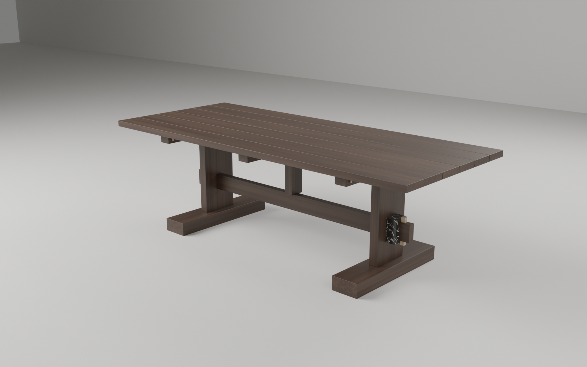
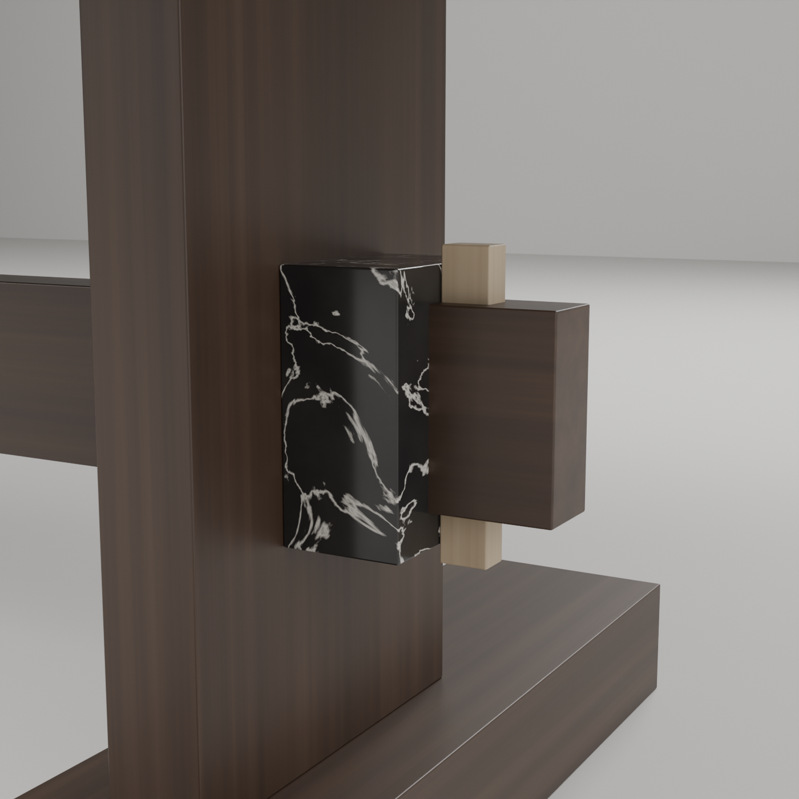

# Mesa · Porada International Design Award 2026

Proyecto de mesa de madera maciza para la XIV edición del concurso Porada, dedicada a las mesas. Cierre: 31-01-2027. Se trabaja con el método del autor: **reunir → desarmar → proponer → ensayar → contrastar → decidir → consolidar**, con retornos. La regla es que ningún contraste se omite y que cada incorporación resuelve una dificultad identificada.

> ⚠️ **Antes de nada**: el concurso exige proyectos **inéditos y anónimos**, y este repositorio es **público**. Ver [`00_encargo/bases.md`](00_encargo/bases.md#️-condiciones-que-afectan-a-cómo-usamos-github).

## Estado al 26-10-2026: propuesta final, iteración 1

**F1 · «Punto fermo»** (título provisional): una mesa de caballetes de nogal canaleta macizo, con una piedra en la unión. → [`05_consolidar/propuesta_final.md`](05_consolidar/propuesta_final.md)

- **La regla**: «la madera se mueve y se arma; lo único fijo es la piedra donde se traba».
- **La mesa**:
  - Seis tablas sueltas de 2400 × 164 × 40 mm, clavijadas en su eje y trabadas por 12 cuñas de fresno que atraviesan los cabezales. La junta entre tablas pasa de 0,8 mm (húmedo) a 4,8 mm (seco).
  - La espiga del travesaño atraviesa el montante y un collar de **Nero Sahara Noir** que trabaja solo a compresión (0,08 MPa); una llave de fresno lo aprieta.
  - 48 piezas, 106,7 kg, ningún herraje; la pieza más pesada es un caballete encolado de 16,0 kg. ✓ K1-K5, 0 interferencias (E12).
- **Cómo se llegó**:
  - La pregunta cambió con Bertonio (*chhakhua*: la unión, no el lastre).
  - La propuesta A (desde el concepto del autor) y la B (desde la bibliografía, sin la premisa) resultaron ser la misma regla vista desde dos lados.
  - F1 es su síntesis, corregida por E12: al pasar AB a planos de construcción, la clavija de las tablas centrales caía dentro del montante, y la exterior asomaba por el cabezal.
- **La decisión no está cerrada**: si E6 (el nodo 1:1) muestra que el collar se lee como adorno, la propuesta pasa a B2. Está prerregistrado.

| | |
|---|---|
|  |  |

**Entregables** (todos se arman con [`05_consolidar/editorial/armar.py`](05_consolidar/editorial/README.md)):

| | |
|---|---|
| **El libro del proyecto** | [`punto_fermo_libro.pdf`](05_consolidar/editorial/punto_fermo_libro.pdf), 82 páginas: el método, las fuentes, los ensayos, la bitácora como guion, los planos, el nodo a 1:1 y lo que falta. La doble página es el tablero a 1:5 |
| **Láminas del concurso** | [`boards_CODICE.pdf`](05_consolidar/concurso/boards_CODICE.pdf): 3 A3, 0,9 MB (máx. 5), en inglés y sin nombre |
| **Informe** | [`report_CODICE.pdf`](05_consolidar/concurso/report_CODICE.pdf): 2565 caracteres (máx. 3000), una página A4 |
| **Vista previa** | [`preview_CODICE.jpg`](05_consolidar/concurso/preview_CODICE.jpg): 0,1 MB (máx. 1) |
| **Planos de construcción** | [`05_consolidar/planos/`](05_consolidar/planos/): planta, alzados, sección A-A, el nodo, tablas, axonometría, despiece y montaje, en SVG acotado |

## Mapa

Los números ordenan carpetas, no el tiempo.

| Carpeta | Movimiento | Qué hay |
|---|---|---|
| [`00_encargo/`](00_encargo/) | reunir | bases verificadas (PDF oficiales), materiales de Porada, dudas para los organizadores |
| [`01_reunir/`](01_reunir/) | reunir | [fichero](01_reunir/fichero.md) de 17 fichas con página, transcripción y dudas; [capturas](01_reunir/capturas/) de dominio público; referencias visuales del autor |
| [`02_desarmar/`](02_desarmar/) | desarmar | [referencias](02_desarmar/referencias.md) (qué se toma, cambia, deja y por qué), [problema](02_desarmar/problema.md) (partes, relaciones, acciones, conflictos, criterios K1-K10), [objeciones](02_desarmar/objeciones.md) |
| [`03_proponer/`](03_proponer/) | proponer | [versiones A](03_proponer/versiones.md), [propuesta B](03_proponer/propuesta_B.md), [síntesis](03_proponer/sintesis.md), [láminas SVG A3](03_proponer/laminas/) |
| [`04_ensayar/`](04_ensayar/) | ensayar · contrastar · decidir | [ensayos](04_ensayar/ensayos.md) con prerregistro, resultado, contraste y decisión; [resultados por ronda](04_ensayar/resultados/) |
| [`05_consolidar/`](05_consolidar/) | decidir · consolidar | [propuesta final](05_consolidar/propuesta_final.md); [entregables, dependencias y calendario](05_consolidar/entregables.md); [planos](05_consolidar/planos/); [concurso](05_consolidar/concurso/); [el libro y su sistema editorial](05_consolidar/editorial/README.md); [renders](05_consolidar/renders/); [modelos 3D base](05_consolidar/modelos/) |
| [`instrumentos/`](instrumentos/) | (todos) | instrumento paramétrico en Python: cálculo, láminas, OBJ, **modelo constructivo y planos de F1** ([README](instrumentos/README.md)); **modelo de Blender** con Geometry Nodes, materiales procedurales y renders que corren en la nube ([README](instrumentos/blender/README.md)) |
| [`bitacora.md`](bitacora.md) | decidir | cada decisión con su porqué y su siguiente acción |

## Cómo se aplicó el método

- **Contrastes elegidos para este proyecto**, porque es un proyecto técnico y material con una retórica:
  - **cálculo** para uso, cuerpo, material y uniones (E1-E4, E8, E9, E2b, E11);
  - **contraste con fuentes** para la palabra y el tipo (E5, F02, F09);
  - **pruebas físicas** para la percepción y el uso (E6, E10);
  - **antecedentes** para la originalidad (E7).
  
  Cada ensayo dice **qué no demuestra**.
- **Prerregistro**: los umbrales se fijaron antes de calcular y quedaron en git. Los de A están en `7e6165b`, antes del instrumento. Los de B, en `38a6dc6`, antes de su cálculo. Cuando un contraste no tuvo prerregistro (E5) o hubo cuentas a mano previas (E8, E9, E11), se dice.
- **El ensayo puede contradecir**. Se descartaron V0, V1, V2, B1 y la cuña por gravedad (E11). La frase del borrador se retiró. Cuando un resultado favorecía la idea del autor (E3, ronda 1: el lastre sí ayudaba), también se registró.
- **Control de expansión**: cada pieza nueva responde a una dificultad identificada:
  - V0b y V4 salen de E1 y E4;
  - B2 sale de E8, E9 y E2b;
  - el exportador OBJ sirve para la lámina 3;
  - los renders de Blender sirven para E6a y E10a, que se pidieron antes de las maquetas.
  
  - el modelo constructivo y los planos de F1 los pide la lámina 2; al hacerlos aparecieron los dos errores de E12;
  - el libro reúne el proyecto para el autor y para quien lo siga en el taller; las láminas y el informe son lo que pide el bando.

  No se hizo atlas ni aplicación web, porque ninguna decisión depende de ellos.

## Decisiones pendientes del autor

1. **Visibilidad del repositorio** hasta el fallo (26-02-2027). Hoy es público y ya contiene las láminas del concurso (O7).
2. **Hacer E6a y E10a** con cinco personas ([hoja](04_ensayar/E6a_E10a_hoja.md)), y **construir E6 y E10** (maquetas 1:1). Si E6 dice «adorno», la propuesta final pasa a B2.
3. **El título y la frase**: «Punto fermo» y «la madera se mueve y se arma; lo único fijo es la piedra donde se traba» son provisionales (O6).
4. **La piedra**: se mantuvo el Nero Sahara Noir del catálogo. Falta pedir la muestra y la ficha (EN 12372). El granito de Comanche queda registrado como alternativa.
5. **Registrarse** en el concurso para tener la plantilla de las láminas y el código del participante (`armar.py --codigo`).
6. **Revisar Bertonio 2011, p. 330**, y corregir el artículo si corresponde (O1).
7. **Cotejar de primera mano la cita de Galen Johnson** (F15): hoy tiene página, pero viene del cotejo hecho en *Contenida*.
