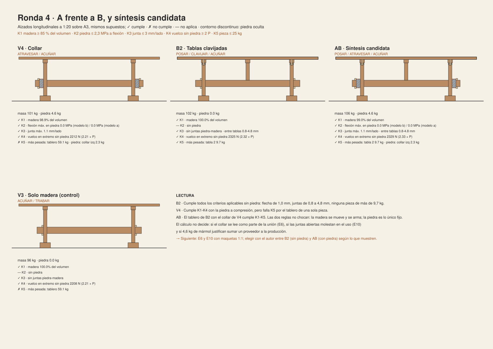

# Mesa · Porada International Design Award 2026

Proyecto de mesa de madera maciza para la XIV edición del concurso Porada, dedicada a las mesas. Cierre: 31-01-2027. Se trabaja con el método del autor: **reunir → desarmar → proponer → ensayar → contrastar → decidir → consolidar**, con retornos. La regla es que ningún contraste se omite y que cada incorporación resuelve una dificultad identificada.

> ⚠️ **Antes de nada**: el concurso exige proyectos **inéditos y anónimos**, y este repositorio es **público**. Ver [`00_encargo/bases.md`](00_encargo/bases.md#️-condiciones-que-afectan-a-cómo-usamos-github).

## Estado al 26-10-2026

- **La pregunta cambió.** El borrador decía: «la gravedad de la piedra sostiene la ligereza del armazón». Bertonio (1612) distingue *chakhua* (montón) de *chhakhua* (piedra hincada donde se atan los palos). Los ensayos mostraron que la piedra no puede ser viga (E1), que no puede ser llave (E4) y que su peso ni traba ni hace falta para estabilizar (E3, E4). La pregunta vigente es **cómo se une la madera a una piedra fija**, y la propuesta B agrega otra: **cómo se muestra que la madera se mueve**.
- **Dos propuestas y una síntesis** ([`03_proponer/sintesis.md`](03_proponer/sintesis.md)):
  - **A · V4 Collar**, desde el concepto del autor: la espiga atraviesa un bloque de mármol que trabaja solo a compresión. Cumple K1-K4 y falla K5 (tablero de 59 kg).
  - **B · B2 Tablas clavijadas**, propuesta propia desde la bibliografía, sin la premisa de la piedra: 6 tablas sueltas, clavijadas y acuñadas; la junta muestra la estación. Cumple todo lo aplicable, sin piedra.
  - **AB**: el tablero de B2 con el collar de V4. Cumple K1-K5. Regla común: **la madera se mueve y se arma; lo único fijo es la piedra donde se traba**.
- **Lo que decide entre B2 y AB no es un cálculo**: es E6 (¿el collar se lee como unión o como adorno?) y E10 (¿las juntas molestan en el uso?). Las dos son pruebas físicas, pendientes.

## Mapa

Los números ordenan carpetas, no el tiempo.

| Carpeta | Movimiento | Qué hay |
|---|---|---|
| [`00_encargo/`](00_encargo/) | reunir | bases verificadas (PDF oficiales), materiales de Porada, dudas para los organizadores |
| [`01_reunir/`](01_reunir/) | reunir | [fichero](01_reunir/fichero.md) de 17 fichas con página, transcripción y dudas; [capturas](01_reunir/capturas/) de dominio público; referencias visuales del autor |
| [`02_desarmar/`](02_desarmar/) | desarmar | [referencias](02_desarmar/referencias.md) (qué se toma, cambia, deja y por qué), [problema](02_desarmar/problema.md) (partes, relaciones, acciones, conflictos, criterios K1-K10), [objeciones](02_desarmar/objeciones.md) |
| [`03_proponer/`](03_proponer/) | proponer | [versiones A](03_proponer/versiones.md), [propuesta B](03_proponer/propuesta_B.md), [síntesis](03_proponer/sintesis.md), [láminas SVG A3](03_proponer/laminas/) |
| [`04_ensayar/`](04_ensayar/) | ensayar · contrastar · decidir | [ensayos](04_ensayar/ensayos.md) con prerregistro, resultado, contraste y decisión; [resultados por ronda](04_ensayar/resultados/) |
| [`05_consolidar/`](05_consolidar/) | consolidar | [entregables, dependencias y calendario](05_consolidar/entregables.md); [modelos 3D base](05_consolidar/modelos/) |
| [`instrumentos/`](instrumentos/) | (todos) | instrumento paramétrico en Python: cálculo, láminas y OBJ ([README](instrumentos/README.md)) |
| [`bitacora.md`](bitacora.md) | decidir | cada decisión con su porqué y su siguiente acción |

## Cómo se aplicó el método

- **Contrastes elegidos para este proyecto**, porque es un proyecto técnico y material con una retórica:
  - **cálculo** para uso, cuerpo, material y uniones (E1-E4, E8, E9, E2b);
  - **contraste con fuentes** para la palabra y el tipo (E5, F02, F09);
  - **pruebas físicas** para la percepción y el uso (E6, E10);
  - **antecedentes** para la originalidad (E7).
  
  Cada ensayo dice **qué no demuestra**.
- **Prerregistro**: los umbrales se fijaron antes de calcular y quedaron en git. Los de A están en `7e6165b`, antes del instrumento. Los de B, en `38a6dc6`, antes de su cálculo. Cuando un contraste no tuvo prerregistro (E5) o hubo cuentas a mano previas (E8, E9), se dice.
- **El ensayo puede contradecir**. Se descartaron V0, V1, V2 y B1. La frase del borrador se retiró. Cuando un resultado favorecía la idea del autor (E3, ronda 1: el lastre sí ayudaba), también se registró.
- **Control de expansión**: cada pieza nueva responde a una dificultad identificada:
  - V0b y V4 salen de E1 y E4;
  - B2 sale de E8, E9 y E2b;
  - el exportador OBJ sirve para la lámina 3.
  
  No se hizo atlas, aplicación web ni renders, porque todavía no hay decisión que dependa de ellos.

## Decisiones pendientes del autor

1. **Visibilidad del repositorio** hasta el fallo (26-02-2027).
2. **Construir E6 y E10** (maquetas 1:1) y, con su resultado, elegir **B2 o AB**.
3. **La frase del concepto** (candidatas en la [bitácora](bitacora.md), entradas 6 y 9) y **el nombre** (O6: usar una palabra aymara como nombre de producto).
4. **El mármol**: de catálogo, por ejemplo Saint Laurent, o andesita. Hay que consultar a los organizadores.
5. **Revisar Bertonio 2011, p. 330**, y corregir el artículo si corresponde (O1).
6. **Confirmar la cita de Galen Johnson** (F15), que viene de la tesis *Contenida*.
